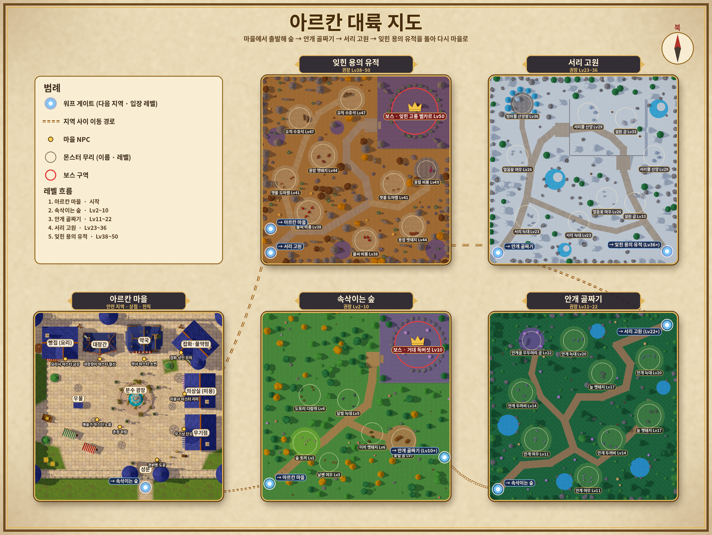

# 아르칸 연대기 — 개발 현황

최종 갱신: 2026-11-01
웹 실행본: https://claude.ai/artifact/Dqi2u1Let3csAC62MEdAZZ (비공개)
저장소: https://github.com/shangho90-sudo/arcan-chronicle

> 이 문서는 작업할 때마다 이어서 갱신합니다. 새 항목은 맨 아래 "변경 기록"에 날짜와 함께 추가하세요.

## 기술 구성
- 웹: three.js r160 (저장소 포함 `vendor/three-r160`, 로컬 import map, 빌드 없음), 쿼터뷰 직교 카메라 (피치 38°, 요 45°, 세로 반폭 5.2 m, 최소 가로 12 m)
- 데이터: `assets/data/*.json`, 스킬은 `tools/skills2/gen.py`로 생성
- 원래 Unity 6.3 LTS 프로젝트가 있었으나, 아래 기능은 **웹 버전에만** 반영됨

## 핵심 결정
- 판정은 발 위치 기준, 텔레그래프와 피격 판정은 같은 HitShape
- 레벨 상한 **50** (Lv15~49 경험치: `round(1200·(L/14)³/10)·10`, Lv49 → 51,450)
- 1차 전직 **Lv10**, 2차 전직 **Lv30 + 전직 시험 퀘스트**
- 저장 버전 3. 구 저장(v2)은 직업 유지(legacyJob), 예전 직업 스킬은 비활성(legacySkills)

## 직업·스킬
- 12직업 × 3계열 × 5 = **180 스킬** (약사/양약사/한약사, 요리사/쉐프, 대장장이/엔지니어, 미용사/디자이너, 예술가/화가/음악가)
- 포인트: Lv10에 5, 레벨당 +1, 2차 전직 +5. 일반 스킬 최대 Lv5, 궁극기 최대 Lv3(Lv45 이상)
- 슬롯: 일반 4개(1~4) + 궁극기 1개(R). 쿨타임은 슬롯 교체·재접속 후에도 유지. 초기화는 마을에서만
- 상태이상(보스 규칙 포함), 표식, 소환, 벽, 제작/분해(원자적 처리)
- 이펙트 연출 등급 = `(차수-1)·3 + 스킬Lv` (궁극기 `+2+Lv`), 최대 10
  - 마법: 등급이 높을수록 입자·고리·빛기둥·화면 흔들림 증가
  - 물리: 스킬 Lv 2마다 연타 +1, 총 피해는 거의 유지(추가타당 +6%)

## 월드·3D 자산
- 마을: 중세 성 (분수·약국·대장간은 Tripo 모델, 나머지 상점·성벽·탑은 절차 모델링)
- 사냥터: 속삭이는 숲, 안개 계곡, 서리 고원, 용의 폐허(보스)
- 주인공 Tripo 모델 + IK 보행, 마을 NPC 9명 Tripo
- 몬스터: 동물형(토끼·다람쥐·여우·멧돼지·늑대·곰) + 고레벨 몬스터 16종
- 워프 게이트, 무기·포션·재료 3D 아이템과 아이콘

## 화면 연출 (2026-11-01)
- 첫 로딩: 사용자 제공 성 마을·로고 일러스트(`assets/ui/loading-screen.png`). 원본 전체 비율 유지, 화면 여백은 배경으로 채움. 그림의 고정 62% 위에 데이터·자원·텍스처·마을 준비 단계 기반 진행률 표시(전송 바이트 비율 아님).
- `js/post.js`: 블룸(빛 번짐), 따뜻한 색보정, 비네트. 설정 → "그래픽 효과"로 끌 수 있음
- 화면 위아래 흐림(틸트시프트)은 사용자 요청으로 **제거** (`Post.params.tilt = 0`, 흐림 계산도 건너뜀)
- 마을: 크림색 판석 텍스처(`tools/town/texgen2.py`), 꽃무늬 돌 장식, 꽃잎, 나뭇잎 그림자, 화분·깃발 가로등, 황금빛 햇빛
- HUD: 금테 패널, 아이콘 메뉴 버튼, 금테 원형 행동 버튼, 장식형 EXP 바

## 속삭이는 숲 그래픽 개편 (2026-11-01)
- 구현: `js/nature.js` (zones.json forest에 `"nature"` 표시). 빌더의 평평한 바닥·원뿔 나무·상자 소품은 숨기고 새로 그림
  - 지면: 햇빛 잔디·그늘 잔디·흙·이끼를 마스크와 노이즈로 섞는 셰이더, 두 번 샘플링으로 반복 무늬 완화
  - 흙길: 존 데이터의 경로를 곡선으로 다듬고 폭을 조금씩 바꿔 그림, 가장자리는 잔디가 파고들게 처리, 작은 돌 인스턴싱
  - 나무 4종·덤불 2종·바위 2종·그루터기·석주·버섯: Tripo3D로 생성(`assets/forest/README.md`에 작업 ID와 조건), 모델별·16 m 청크별 인스턴싱, 그림자는 저폴리 사본으로
  - 풀·꽃: 화면을 향하는 카드(손그림 텍스처 아틀라스, 바람 흔들림, alpha-to-coverage), 숲 가장자리와 길 어깨에 밀도 높게, 몬스터 캠프 주변은 낮게
  - 플레이어 앞을 가리는 나무·바위는 디더링으로 구멍을 뚫어 보이게 함
- 배치: `tools/forest/layout.py` (시드 20261101). 나무 168·덤불 237·바위 16·그루터기 6·꽃 무리 63, 보스 바위·석주·표지판·버섯은 기존 위치 유지
  - 충돌은 나무·바위·그루터기만. 걸을 수 있는 칸 88.5% → 86.5%, 포털 2·스폰 3·몬스터 캠프 6·보스 입구 모두 도달 확인(`check_nav.mjs`)
- 조명: 숲 햇빛 [1.0, 0.86, 0.64]·세기 1.4, 존별 후처리(비네트 0.22, 블룸 0.35)
- UI: 남색+얇은 금테로 정리, 초상화를 3D 모델 얼굴 렌더(`js/portrait.js`)로 교체, 휴대폰 세로/가로 배치 겹침 수정
- 카메라: 세로 반폭 5.625 → 5.2 (캐릭터 화면 높이 약 12.5% → 13.6%, 1280×880 기준), 세로 휴대폰 최소 가로 17 → 12 m

## 캐릭터 보행 개선 (2026-11-01)
- 확인된 원인 (`tools/browser-tests/gait_probe.js`로 실제 게임 이동 코드를 60 Hz로 돌려 발·골반 뼈 위치를 측정, `gait_report.py`로 분석)
  - 발 교대가 너무 빠름: 4.6 m/s에서 초당 약 4.3~5걸음, 보폭 0.9 m. 디딤 거리를 다리 길이로 묶은 뒤 그만큼 발을 더 빨리 돌려 속도를 맞추는 구조였음
  - 디딘 발이 미끄러짐: 직선 달리기 중에도 디딘 발이 평균 약 1.1~1.2 m/s로 움직임. alignLegs가 IK 뒤에 허벅지를 수직축·전후축으로 돌려 접지 위치를 옮기고, 골반 비틀림이 고관절 위치를 옮기는 것을 IK가 반영하지 않았음
  - 방향 전환 시 디딘 발이 몸과 함께 회전(180° 전환 때 최대 약 107°)하고 미끄러짐
  - 출발 직후 키프레임 걷기 동작이 섞이며 발이 끌리고, 벽에 막히면 제자리에서 발을 끌며 걷는 동작 반복
- 수정 (`js/model.js`, `js/actors.js`)
  - 보폭·발 교대 주기를 속도와 다리 길이로 계산: 4.6 m/s에서 남 약 3.5, 여 약 3.75걸음/초(다리가 짧은 여자 모델이 조금 더 빠름), 남는 거리는 짧은 체공으로
  - 다리 3D IK: 골반 비틀림으로 움직인 고관절에서 목표 발목(보폭, 좌우 간격 13 cm 안팎, 발끝 4~6° 바깥)으로 직접 풀어 무릎은 발끝 방향, 발 방향·기울기까지 최종 발 위치에 포함. alignLegs는 서 있기·공격 등 키프레임 자세에만 적용
  - 발 고정: 디딘 발은 땅(월드 좌표)의 위치·방향을 유지하고, 떼는 순간의 실제 위치에서 다음 착지점으로 스윙. 급회전처럼 너무 멀어지면 초과분만 끌림
  - 뒤꿈치 들기 때 발끝을 축으로 회전(발끝 고정), 발 들기 높이 24 → 15 cm, 골반 상하·비틀림, 팔 흔들기, 상체 숙임을 줄임
  - 걷기 중 바탕 자세를 키프레임 걷기 대신 서 있기로, 보행 섞임 속도 상향, 벽에 막히면 서서 벽을 바라봄. 공격·피격·대시는 기존 키프레임 유지
- 측정 결과 (변경 전 → 후, 남/여): 4.6 m/s 직선 디딘 발 이동 약 1.1~1.2 → 0.07~0.10 m/s(남는 값은 뒤꿈치 들기 회전), 발 좌우 간격 약 0.21 → 0.13 m, 땅 파고듦 최대 약 3 cm → 0.4 cm, 출발 구간 미끄러짐 약 1.1~1.2 → 0.2~0.3 m/s
- 남은 한계: 180°·90° 급회전 때 디딘 발이 발끝 축으로 최대 약 50° 돌고 일부 끌림(남 0.3~0.6, 여 약 0.9 m/s). 정지 직후 0.2초 블렌드 동안 약간 미끄러짐(0.2~0.45 m/s). 대시·공격 중 다리는 키프레임이라 발이 미끄러질 수 있음

## 검증 상태
- 로직 테스트: `node tests/core.test.mjs` 323 통과/6 생략, `node tests/skills2.test.mjs` 576 통과
- 브라우저 자동 테스트: 180개 스킬 전부 시전, 콘솔 오류 없음
  - 효과 미측정: pt_c5(증폭할 장판·소환수가 없을 때), ar1_c1(MP가 가득 차 회복량 측정 불가)
- 마을·숲·용의 폐허 스크린샷 확인
- 숲 화면 검증(`tools/browser-tests/forestshots.js`, 헤드리스 Chromium + SwiftShader 소프트웨어 렌더): 정지·이동·나무 근접·나무 뒤·전투, 1280×880 / 390×844 / 844×390
- 숲 렌더 부하(1280×880, 같은 위치, 한 프레임): 변경 전 약 64만 삼각형·194 draw call → 변경 후 약 147만 삼각형·177 draw call. SwiftShader 프레임 시간은 1.2 s → 3.3 s(소프트웨어 렌더라 실제 GPU 수치가 아님)
- **미확인**: 사람이 처음부터 끝까지 플레이한 검증, 실제 GPU·휴대폰 기기에서의 프레임 속도

## 남은 일
1. 실기기·휴대폰에서 성능과 스킬 버튼 배치 확인 (느리면 "그래픽 효과" 끄기)
2. 스킬 아이콘 정식 제작 (현재 코드 생성 임시 아이콘)
3. 4족 몬스터 공격·피격·죽음 애니메이션 (현재 걷기만 Tripo, 나머지 절차 동작)
4. 참고 이미지 대비 부족한 소품: 분수 주변 꽃 더 풍성하게, 벤치·나무통·전경 수풀
7. 숲: 실제 기기 성능 측정 후 필요하면 나무 원본 메시 감량(UV 섬 때문에 현재 9천 삼각형 안팎), 잎 사이 빛 무늬, 다른 사냥터에도 같은 방식 적용, 보스 단(보라색 바닥·돌벽)은 아직 예전 표현
5. Unity 프로젝트에 반영
6. Tripo API 키 교체 권장 (대화에 노출됨, 잔여 크레딧 약 625)

## 변경 기록
- 2026-10-31: 3D 캐릭터·IK 보행, 마을 NPC Tripo 모델
- 2026-11-01: 3D 성 마을, 동물형 몬스터, 워프 게이트, 3D 아이템
- 2026-11-01: 직업·스킬 180종, 제작, 고레벨 사냥터 3곳, 레벨 상한 50, 이펙트 등급
- 2026-11-01: 예전 꽃 장식 큐브와 분수 위 2D 물보라 제거
- 2026-11-01: GitHub 저장소 생성, AGENTS.md / CLAUDE.md / README.md 추가
- 2026-11-01: 황금빛 화면 연출, 장식 가로등·문양 바닥·꽃잎·나뭇잎 그림자, 금테 UI
- 2026-11-01: 화면 위아래 흐림 제거, 개발 현황 문서(docs/STATUS.md) 추가

- 2026-11-01: 첫 로딩 화면을 사용자 제공 성 마을 일러스트로 변경하고 실제 준비 단계 진행 표시 및 오류 안내 유지.

- 2026-11-01: 시작 메뉴를 사용자 제공 분수 마을 일러스트로 교체. 실제 이어하기·새 게임 버튼, 저장 정보, 저장 없음 비활성화, 키보드 포커스 및 세로 화면 배치 적용. GitHub Pages 정적 배포용 .nojekyll 추가.
- 검증: 핵심 323 통과/6 생략, 스킬 576 통과. Edge 실제 부팅·저장 없음·새 게임 캐릭터 생성 이동·저장 정보가 있을 때 이어하기 콜백 확인, 1088×918 및 390×844 화면 확인.

- 2026-11-01: 캐릭터 선택 화면을 사용자 제공 판타지 모험가 일러스트로 변경. 소년·소녀 선택 강조, 캐릭터별 이름 유지, 주사위 이름 추천, 빈 이름 방지, 뒤로·모험 시작 및 모바일 입력 배치 적용. 캐릭터 모델과 저장 형식은 유지.
- 검증: 핵심 323 통과/6 생략, 스킬 576 통과. Edge 실제 부팅 후 캐릭터 선택·이름 유지·추천·빈 이름 방지·시작 인자·뒤로 동작 검증. PC 1088×918 및 모바일 390×844 화면 확인.

- 2026-11-01: 외부 CDN 차단 시 첫 로딩이 0%에서 멈추는 현상 재현. 기존 Three.js r160 및 필요한 addon·LICENSE를 vendor/three-r160에 포함해 같은 사이트에서 제공. 모듈 불러오기 실패 안내·재시도 버튼과 30초 지연 안내 추가.
- 검증: CDN 차단 상태 부팅 및 메뉴/캐릭터 선택 통과. 엔진 요청 차단 시 실패 안내와 재시도 버튼 확인. 핵심 323 통과/6 생략, 스킬 576 통과.

- 2026-11-01: 캐릭터 선택의 금색 테두리·클릭 영역을 소년/소녀 설명 카드에 맞춤(상단 30.1%, 너비 21.5%, 높이 31.5%). PC·모바일 화면 및 선택 동작 확인. 핵심 323 통과/6 생략, 스킬 576 통과. 요청한 Runway 새 배경음악은 연결된 무료 플랜의 음악 생성 제한으로 미적용.

- 2026-11-01: 월드맵(docs/worldmap.png) — 실제 게임 지형을 위에서 렌더해 합성 (`tools/worldmap/capture.js` → `compose.py`)

## 배경음악 (2026-11-01)
- 시작·캐릭터 선택: 돌아오는 햇살 / 마을: 돌아오는 빛
- 속삭이는 숲: 잎새 사이의 약속 / 안개 골짜기: 안개 너머의 약속
- 서리 고원: 눈꽃의 약속 / 잊힌 용의 유적: 잊히지 않는 서약
- 사용자가 선택한 Runway 원본 MP3 6곡을 assets/audio/bgm_arcan_*.mp3로 포함. 제목·원본 작업 ID는 music-credits.json에 기록. 보스 음악은 기존 설정 유지.
- 첫 클릭·키 입력 후 재생하며 지역별 반복 재생, 기존 음악 볼륨 설정 사용.
- 2026-11-01: 요청한 6곡 연결. Edge에서 MP3 전체 디코딩, 시작/선택 음악 유지, 실제 마을·4개 필드 이동과 음악 전환, 음소거, 타이틀 복귀 확인. 핵심 테스트 323 통과/6 생략, 스킬 테스트 576 통과.
- 2026-11-01: 속삭이는 숲 그래픽 개편 — Tripo 나무·덤불·바위, 손그림 지면 셰이더와 곡선 흙길, 풀·꽃 카드, 구역별 배치(충돌·경로 갱신), 가림 디더링, 남색 UI와 3D 초상화, 휴대폰 UI 겹침 수정
- 2026-11-01: 캐릭터 보행 개선 — 속도·다리 길이 기반 보폭과 발 교대, 3D 다리 IK(간격·발끝 방향 포함), 디딘 발 월드 고정, 회전·출발·정지·벽 막힘 처리, 동작 과장 완화. 측정 도구 gait_probe.js / gait_report.py / gait_film.js
